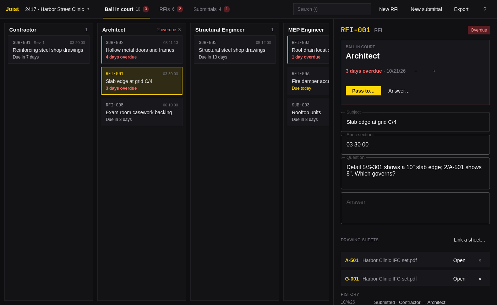

# Joist

RFI and submittal logs for construction projects, for
[Omarchy](https://omarchy.org). Every open item is held by one party on the
project team, and Joist shows you who: the ball is in their court.



## What it does

- Keeps a project's RFIs and submittals, numbered as the trade numbers them
  (`RFI-001`, `SUB-012`), with their subject, spec section, question, and
  answer or review comments.
- **Ball in court**: a column for each party on the team, holding the items
  they owe an answer on, most urgent first. Overdue items go red.
- Passes an item between parties with a new due date and a note, and keeps
  the whole history. Answering an RFI or reviewing a submittal closes it;
  **Revise and resubmit** sends a submittal back to whoever submitted it as
  its next revision.
- Sends a desktop notification for each overdue item (and each item due
  today) once a day, while the window is open, and from a systemd user timer
  when it isn't.
- Links items to sheets in a [Lintel](https://github.com/yamz8/lintel) drawing
  set, picked from the sheets Lintel lists, and opens them in Lintel.
- Exports the RFI log, the submittal log, the ball-in-court report, and a
  form for any one item as PDF, on Letter or A4 to match your locale.
- Saves every change as it's made, with undo, to
  `~/.local/share/joist/projects/`. A change made from the command line shows
  up in the open window.
- Follows the Omarchy theme accent, window rounding, and language live.

## Usage

```sh
joist open                     # or Joist from the app launcher
joist open 2417                # a project by number, name, or file
```

Overdue notifications while Joist is closed come from a user timer, which
you turn on once:

```sh
systemctl --user enable --now joist-notify.timer
```

### For scripts and coding agents

These need no display, take `--json`, and exit 0 or 1 with errors on stderr.
Name the project with `-p` when there's more than one.

```sh
joist projects                                  # every project, with open and overdue counts
joist new "Harbor Street Clinic" -n 2417
joist add rfi "Slab edge at grid C/4" -p 2417 -q "Which detail governs?" --spec "03 30 00"
joist pass RFI-1 Architect -p 2417 --due-in 5 --note "Needs the structural answer"
joist close RFI-1 answered -p 2417 --answer "Use 5/S-302."
joist close SUB-4 revise-resubmit -p 2417       # back to the submitter as revision 1
joist list -p 2417 --overdue --json
joist link RFI-1 drawings.pdf A-101 -p 2417
joist export board -p 2417 -o ball-in-court.pdf # also rfi, submittal, or RFI-1 for its form
joist notify --dry-run                          # what would be announced now
joist skill install                             # teach your coding agents to use Joist
```

## Shortcuts

| Key | Action |
| --- | --- |
| `1` / `2` / `3` | Ball in court, RFI log, submittal log |
| `J` / `K`, `Down` / `Up` | Next and previous item |
| `R` | New RFI |
| `S` | New submittal |
| `Space` | Pass the ball to another party |
| `C` | Answer or review the item; reopen a closed one |
| `]` / `[` | Due a day later or earlier |
| `Enter` | Edit the subject |
| `L` | Link a Lintel sheet |
| `O` | Open the linked sheet in Lintel |
| `F` | Export the item's form as PDF |
| `E` | Export this view as PDF |
| `/` | Search |
| `H` | Show or hide closed items |
| `P` | Switch or start a project |
| `T` | Project and team |
| `Delete` | Delete the item |
| `Ctrl+Z` / `Ctrl+Shift+Z` | Undo and redo |
| `Esc` | Leave a field, or step back |
| `?` | Show or hide shortcuts |
| `Q` | Quit |

In the pass and review dialogs, `Up` / `Down` or a number picks, and
`Enter` confirms.

## Build

Joist is C++ and Qt Quick, built with qmake. It needs Qt 6.7 or later
(`qt6-base` and `qt6-declarative` on Arch), and `notify-send` from libnotify
for notifications.

```sh
bin/build      # builds build/joist
bin/test       # runs the tests offscreen
bin/install    # builds and installs the Arch package with makepkg, so Joist is in the app launcher
```

## License

MIT. The theme and portal file picker code follows
[Omacut](https://github.com/omacom-io/omacut) by David Heinemeier Hansson, also MIT.
